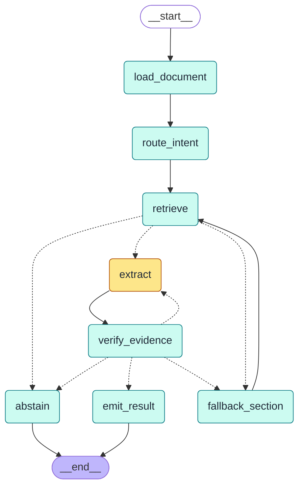

# Architecture

> 그림은 코드에서 자동 생성한다: `python -m scripts.draw_graph --write` → `docs/graph.mmd`
> 노드·엣지를 바꾸면 **그날** 이 문서의 카드도 고친다.
> 기준 버전: `v1.0` (모드 A · threshold 끔 · max_tokens 2048)

---

## 1. 그래프



- 🟨 **노란색 = LLM을 부르는 노드 (extract 하나뿐)**
- 🟩 청록색 = 코드만 쓰는 노드 (LLM 비용 0)
- 실선 = 항상 가는 길 · 점선 = 조건에 따라 고르는 길

---

## 2. 노드 카드

### load_document · 코드
- **받는 것:** `doc_id`
- **하는 일:** `synthetic_kit/data/synthetic/{doc_id}.txt`를 통째로 읽는다. 나중에 verify가 인용 위치를 원문과 대조할 때 이 원문을 쓴다.
- **바꾸는 State:** `doc_text`
- **실패하면:** 파일이 없으면 예외로 멈춘다.

### route_intent · 코드
- **받는 것:** `question`
- **하는 일:** "What is the discharge dose of X?"에서 약 이름 X를 정규식으로 뽑아 소문자로 만든다. 찾아볼 섹션 순서를 `Discharge Medications → Discharge Instructions`로 정한다.
- **바꾸는 State:** `med_name` · `section_plan` · `section_idx=0` · `attempts=0`
- **실패하면:** 질문 형식이 다르면 약 이름이 빈 문자열이 되고, 결국 abstain으로 끝난다.

### retrieve · 코드 (로컬 임베딩)
- **받는 것:** `question` · `doc_id` · 지금 섹션
- **하는 일:** Chroma에서 **같은 환자 문서 + 같은 섹션**으로 필터를 건 뒤 가장 가까운 조각 3개를 찾는다. threshold는 꺼져 있어서 거리로 버리지 않는다. 섹션 단위로 잘라 두었기 때문에 대부분 섹션 전체가 조각 하나로 온다.
- **바꾸는 State:** `chunks`
- **실패하면:** 그 섹션에 조각이 없으면 다음 섹션으로, 마지막 섹션이면 abstain.

### fallback_section · 코드
- **하는 일:** 다음 섹션으로 넘어가고 재시도 횟수를 0으로 되돌린다. 새 섹션에서는 다시 2번까지 시도할 수 있다.
- **바꾸는 State:** `section_idx + 1` · `attempts=0`

### extract · 🟨 LLM (유일한 LLM 비용)
- **받는 것:** `med_name` · 지금 섹션 · `chunks` · (재시도면) 지난번에 거절된 인용과 이유
- **하는 일:**
  1. LLM에게 "이 섹션에서 그 약의 퇴원 용량이 적힌 줄을 **그대로 베껴라**. 없으면 found=false"라고 묻는다. 답은 `{"found", "quote"}` JSON뿐이다.
  2. **위치는 LLM이 아니라 코드가 찾는다** (`locate`): 조각 범위 안에서 정확히 일치 → 문서 전체에서 일치 → 줄바꿈을 무시하고 일치.
  3. 용량과 복용 빈도는 찾은 원문에서 정규식으로 뽑는다.
  4. 토큰 · 지연 · 모델 · `stop_reason`을 `usage`에 기록한다.
- **바꾸는 State:** `candidate` · `attempts + 1` · `usage`
- **실패하면:**
  - `found=false` → candidate 없음 → verify가 `not_found`
  - JSON이 아님 → candidate 없음 (trace에 `unparseable`)
  - **출력 상한에서 잘림 → trace에 `TRUNCATED`** ("약 없음"과 구분)
  - 원문에 없는 인용(지어냄) → 위치 -1 → verify가 `span_mismatch`

### verify_evidence · 코드 (LLM 0회)
- **받는 것:** `candidate` · `doc_text` · `med_name`
- **하는 일:** 원문을 다시 열어 차례로 검사한다. 하나라도 걸리면 거기서 멈춘다.
  | 순서 | 검사 | 걸리면 |
  |---|---|---|
  | 0 | 후보가 있나 | `not_found` |
  | 1 | 인용 위치의 원문 = 인용 문장 | `span_mismatch` |
  | 2 | 인용 문장에 요청한 약 이름이 있나 | `name_mismatch` |
  | 3 | 위치가 퇴원 섹션 안인가 | `wrong_section` |
  | 4 | 용량이 정확히 1개인가 (0개 / 2개 이상) | `no_dose` / `multiple_doses` |
  | — | 전부 통과 | `ok` |
- **바꾸는 State:** `verdict`

### emit_result · 코드
- **하는 일:** 용량 · 빈도 · 인용 원문 · **원문 위치(evidence_span)** · 섹션을 묶어 결과로 낸다. `admission`(입원 목록 비교)은 아직 비어 있다.
- **바꾸는 State:** `result`

### abstain · 코드
- **하는 일:** 답을 내지 않고 이유를 남긴다. 예: "the drug is listed but no dose is written"
- **바꾸는 State:** `result=None` · `abstain_reason`

---

## 3. 갈림길 (조건부 엣지)

**retrieve 다음 (`after_retrieve`)**
- 조각이 있다 → extract
- 없고 다음 섹션이 있다 → fallback_section
- 둘 다 아니다 → abstain

**verify 다음 (`after_verify`)**
- `ok` → emit_result
- `span_mismatch` · `name_mismatch` · `wrong_section` **그리고** 이 섹션에서 2번 미만 시도 → extract (거절 이유를 알려주고 다시 묻기)
- `not_found` 그리고 다음 섹션이 있다 → fallback_section
- 그 밖 (`no_dose` · `multiple_doses` · 재시도·섹션 소진) → abstain

**질문 1개의 최대 LLM 호출:** 섹션 2개 × 시도 2번 = 4번. 실제 평균은 1.04번.

---

## 4. 질문 1개의 여정 (실제 trace, 10/11 수정 후)

질문: **doc_08 "What is the discharge dose of prednisone?"**
이 문서는 퇴원약 목록에 "See discharge instructions."만 있고, 용량은 퇴원 안내 줄글 속에 있다.

```
load_document: doc_08 (2712 chars)
route_intent: med='prednisone', plan=['Discharge Medications', 'Discharge Instructions']
retrieve[Discharge Medications]: found 1 (dist 0.85), kept 1
extract[A] (attempt 1, 248+15 tok, 1468 ms): found=false
verify_evidence: not_found
fallback_section: -> Discharge Instructions
retrieve[Discharge Instructions]: found 1 (dist 0.82), kept 1
extract[A] (attempt 1, 402+453 tok, 2661 ms): 'please take prednisone 20 mg daily for 4 more days, then stop. Use'
verify_evidence: ok
emit_result: 20 mg daily
```

줄글로 풀면:
1. 문서를 읽고, 질문에서 `prednisone`을 뽑는다.
2. 먼저 퇴원약 목록을 찾는다. 거리 0.85로 꽤 멀지만 threshold가 꺼져 있어서 조각이 LLM에게 간다. (0.68이었다면 여기서 잘려 놓쳤다.)
3. LLM은 목록에 prednisone이 없다고 **정직하게** `found=false`라고 답한다. 출력 15토큰.
4. verify가 `not_found`를 내리고, 다음 섹션인 퇴원 안내로 넘어간다.
5. LLM이 줄글에서 해당 줄을 인용한다. 출력이 **453토큰**: 목록보다 훨씬 오래 생각한다. (상한이 300이던 때는 여기서 잘려 "약 없음"이 됐다.)
6. 코드가 인용을 원문에서 찾고, verify가 4검사를 통과시킨다: 위치 일치 · 약 이름 있음 · 퇴원 섹션 · 용량 1개(`20 mg`).
7. 결과 `20 mg daily` + 원문 위치를 낸다.

---

## 5. 설계 결정 요약 (자세한 근거: design-decisions.md)

| 결정 | 이유 (숫자) |
|---|---|
| LLM은 인용만, 위치는 코드 | 지어낸 인용은 원문에서 못 찾음 → 530문항 틀린 답 0 |
| verify를 코드로 | LLM 호출 0 · 결과가 매번 같음 |
| threshold 끔 | 0.68: 41/46 · 끔: 46/46, 둘 다 틀린 답 0 (regex·LLM 모두) |
| 모드 A (검색 조각) | 모드 D(문서 전체)와 정확도 같음 · 토큰 1/3.5 |
| 섹션 우선 분할 | 섹션이 조각 하나로 와서 LLM이 섹션을 확인 가능 |
| max_tokens 2048 | 줄글 문서는 출력 289~659토큰. 300에서 잘렸음 |

## 6. 한계
- 합성 문서 21건 · 질문 53개. 실제 문서는 더 길고 형식이 들쭉날쭉함
- 섹션이 길어 여러 조각으로 나뉘면 k=3이 정답 조각을 놓칠 수 있음 (모드 D가 다시 필요할 수 있음)
- 섹션 제목이 없거나 다르면 섹션 필터가 아무것도 못 찾음
- 상품명 ↔ 성분명 (예: Tylenol ↔ acetaminophen)은 이름 검사에서 걸러짐
- `compare_admission` (입원 대비 용량 변화)은 아직 미구현
